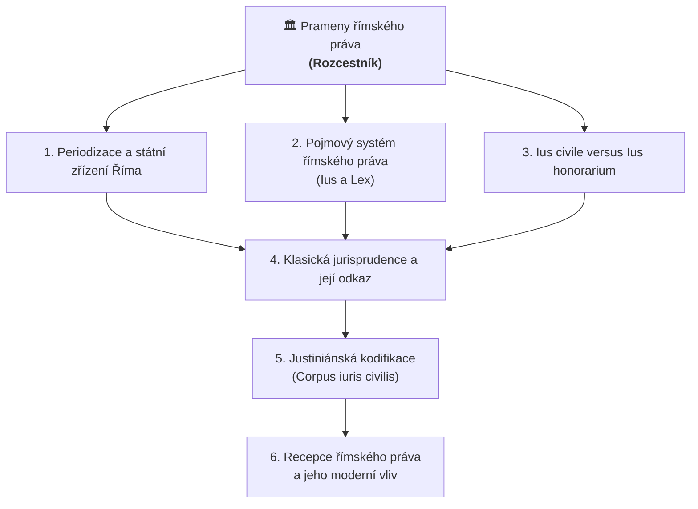

# 🏛️ Prameny římského práva: Úvod, pojmy a prameny (Rozcestník)

Vítej ve studijním rozcestníku k **1. přednášce z Římského práva a základů novodobého práva soukromého I** (prof. JUDr. Petr Bělovský, Dr., Právnická fakulta UK).

Tento rozcestník propojuje látku z přednáškové prezentace, učebnice (*Kincl, Urfus, Skřejpek*) a Tvých výpisků do uceleného studijního systému pro Obsidian.

---

## 🗺️ Mapa nadřazených témat (MOC)

> [!TIP] **Interaktivní navigace mezi hlavními pilíři**
> 1. 🏛️ **[[Periodizace a státní zřízení Říma]]** – chronologie epoch a proměna státních orgánů
> 2. ⚖️ **[[Pojmový systém římského práva (Ius a Lex)]]** – dělení na *ius publicum* a *ius privatum*, základní regule
> 3. ⚔️ **[[Ius civile versus Ius honorarium]]** – napětí mezi rigidním právem občanů a pružnou praetorskou tvorbou (*aequitas*)
> 4. 📜 **[[Klasická jurisprudence a její odkaz]]** – právní věda, responsa a autorita právníků
> 5. 📚 **[[Justiniánská kodifikace (Corpus iuris civilis)]]** – kodifikace tisíciletého vývoje (Digesta, Kodex, Instituce, Novely)
> 6. 🌍 **[[Recepce římského práva a jeho moderní vliv]]** – znovunalezení Digest, glosátoři a přesah do dnešního práva

---

## 📚 Přehled studijních témat a poznámek

### 1. Ústavní vývoj a chronologie
> *Forma práva v Římě vždy věrně zrcadlila charakter a držitele státní moci.*
- **Nadřazené téma:** [[Periodizace a státní zřízení Říma]]
- **Detailní poznámky:**
  - [[Vývojové etapy Říma a atributy zřízení]] – přehled 4 epoch, tabulka moci a vymezení klasického období.
  - [[Království a archaické právo]] – *rex*, kurie, rodová společnost (*gens*), obyčeje (*mos maiorum*), pontifikální monopol.
  - [[Římská republika a její magistratury]] – *comitia*, plebiscita (*Lex Hortensia* 287 př. n. l.), anuita, kolegialita, *ius intercessionis*, přehled úřadů.
  - [[Principát a proměna pramenů práva]] – Augustova fikce republiky, *senatusconsulta*, nástup císařských konstitucí, *Edictum perpetuum* (cca 130 n. l.).
  - [[Dominát a absolutní monarchie]] – Dioklecián, otevřená autokracie (*dominus et deus*), legislativní monopol, dualismus *iura* vs. *leges*.

### 2. Pojmový systém a základní dělení práva
> *Základní kategorie, z nichž vyrostlo evropské právní myšlení.*
- **Nadřazené téma:** [[Pojmový systém římského práva (Ius a Lex)]]
- **Detailní poznámky:**
  - [[Ius publicum a Ius privatum]] – Ulpianova zájmová teorie (D 1, 1, 1, 2), kogentnost veřejného práva vs. dispozitivnost soukromého práva.
  - [[Základní právní regule a principy v Digestech]] – Celsus (*ius est ars boni et aequi*), Ulpianus (3 příkazy práva), Paulus (zákaz obcházení zákona *in fraudem legis*), teleologický výklad.

### 3. Ius civile versus Ius honorarium
> *Dva paralelní světy římského soukromého práva: rigidní tradice vs. dynamická praetorská praxe.*
- **Nadřazené téma:** [[Ius civile versus Ius honorarium]]
- **Detailní poznámky:**
  - [[Ius civile a jeho prameny]] – právo občanů obce, formalismus, liktoři a fasces, 4 prameny (obyčeje, Z12D, pontifikové, leges).
  - [[Ius honorarium a praetorská jurisdikce]] – praetor urbanus a peregrinus, dvoufázový proces (*in iure* vs. *apud iudicem*), Papinianova definice (podpora, doplnění, oprava), Marcianus (živý hlas civilního práva).
  - [[Praetor, edikty a aequitas]] – *ius edicendi*, album, *aequitas*, žaloba (*actio*) jako klíč k právu, mimořádné praetorské prostředky (interdikty, in integrum restitutio).

### 4. Klasická jurisprudence a její autorita
> *Právní věda jako vrcholný přímý pramen práva.*
- **Nadřazené téma:** [[Klasická jurisprudence a její odkaz]]
- **Detailní poznámky:**
  - [[Klasická jurisprudence a její představitelé]] – *respondere*, *cavere*, *agere*; školy Sabiniánů a Prokuliánů; Labeo, Iulianus, Celsus, Gaius, Papinianus, Paulus, Ulpianus, Modestinus.
  - [[Ius respondendi a responsa]] – Augustovo privilegium udílet posudky s autoritou císaře, vázanost soudce, jurisprudence pramenem práva.
  - [[Citační zákony]] – Konstantin (321 n. l.) a kánon pěti právníků Theodosia II. a Valentiniana III. (426 n. l.), mechanický rozhodovací klíč.
  - [[Interpolace v římskoprávních textech]] – Triboniánovy úpravy textů klasiků, důvody zásahů, moderní interpolační kritika.

### 5. Justiniánská kodifikace (Corpus iuris civilis)
> *Největší soukromoprávní kodifikace lidských dějin.*
- **Nadřazené téma:** [[Justiniánská kodifikace (Corpus iuris civilis)]]
- **Detailní poznámky:**
  - [[Corpus iuris civilis - vznik a skladba]] – Justinián I. (527–565 n. l.), 4 součásti díla (Codex, Digesta, Institutiones, Novellae), Dionysius Gothofredus (1583).
  - [[Digesta (Pandectae) a kompilační metoda]] – 50 knih, 9 123 fragmentů, Tribonián a 16 komisařů, Bluhmeova teorie mas (sabiniánská, ediktální, papiniánská).
  - [[Institutiones Justiniána]] – 4 knihy oficiální učebnice s plnou právní silou zákona; přehled obsahu: osoby, věci/dědění, závazky, delikty/žaloby.
  - [[Codex Iustinianus a Novellae]] – 12 knih císařských konstitucí od Hadriána (příklad C 3, 37, 4), Novely převážně v řečtině, zásadní reforma dědického práva (Novela 118 a 127).
  - [[Konstituce Deo auctore a Tanta - Dedoken]] – zahájení prací (530) a vyhlášení (533); zákaz komentování, zákaz zkratek (*sigla*), hrozba trestu za falšování (*crimen falsi*).
  - [[Citace Digest a právní kazuistika (Labeo, Paulus, Ulpianus)]] – metodika citace (`Ulp. D 18, 6, 1, 4`); rozbor případu prodeje vína v sudech a úrazu prodaného otroka (míra péče řádného otce rodiny).

### 6. Druhý život římského práva (Recepce)
> *Jak antické texty vytvořily moderní evropské civilní kodifikace.*
- **Nadřazené téma:** [[Recepce římského práva a jeho moderní vliv]]
- **Detailní poznámky:**
  - [[Recepce římského práva, glosátoři a ius commune]] – znovunalezení rukopisu *Littera Florentina* v 11. stol., univerzita v Bologni (1088), Irnerius, glosátoři (*Glossa ordinaria*), komentátoři, *ius commune*, sv. Ivon, Code civil, ABGB, BGB.
  - [[Kontinuita římského práva v moderním právu (Nepřikázané jednatelství)]] – přímé srovnání Gaia (D 3, 5, 2) a § 3009 platného českého občanského zákoníku (*negotiorum gestio*).

---

## 🔑 Rychlý rejstřík klíčových pojmů (Keys)
- **Základní pojmy a dělení:** [[ius]], [[lex]], [[ius publicum]], [[ius privatum]], [[ius civile]], [[ius honorarium]], [[aequitas]]
- **Instituce a soudnictví:** [[praetor]], [[Zákon dvanácti desek]], [[principát]], [[dominát]]
- **Právní věda a autorita:** [[klasická jurisprudence]], [[ius respondendi]], [[citační zákon]], [[interpolace]]
- **Justiniánské sbírky:** [[Corpus iuris civilis]], [[Digesta]], [[Institutiones]], [[Codex Iustinianus]], [[Novellae]]
- **Recepce a moderní právo:** [[glosátoři]], [[ius commune]], [[nepřikázané jednatelství]]

---

## 📖 Primární zdroje
- [[Přednáška 1 - Prameny římského práva (Bělovský)]] – prezentace z přednášky
- [[Učebnice - Římské právo (Kincl, Urfus, Skřejpek)]] – učebnice (s. 1–48)
- [[Studentské výpisky - Riman prednaska 1]] – Tvoje původní poznámky

---

## 📇 Opakování do Anki
- Export pro Anki (63 kartiček s latinskými i českými definicemi): `[[Anki - Rimske pravo - Prednaska 1.csv]]`
