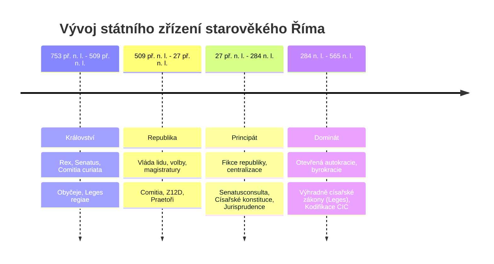

# Nadřazené téma: Periodizace a státní zřízení Říma

## Úvod a syntéza
Vývoj římského státu a forem vlády představuje nezbytný ústavní rámec pro pochopení toho, **kdo, jak a proč tvořil právo**. Forma práva v Římě vždy věrně kopírovala charakter státní moci: od nepsaných rodových obyčejů království přes demokraticko-oligarchické zákonodárství lidu za republiky až po centralizované dekrety princepse a absolutistický monopol dominátu.

---

## Přehled vývojových epoch a jejich institucí

---

## Klíčová podtémata a studijní poznámky

### 1. [[Vývojové etapy Říma a atributy zřízení]]
- Globální srovnávací přehled čtyř základních epoch.
- Tabulka atributů moci a klíčových tvůrců norem.
- Vymezení tzv. **klasického období** (pol. 1. stol. př. n. l. – pol. 3. stol. n. l.), které se nekryje s hranicemi zřízení, ale tvoří vrchol právní dogmatiky.

### 2. [[Království a archaické právo]]
- Rodová společnost (*gens*), kurie a kmenová organizace.
- Instituce: *rex*, *senatus* (rada starších), *comitia curiata*.
- Prameny: *mos maiorum* (obyčej), tradované královské zákony (*leges regiae*), kněžský monopol pontifiků na právo a kalendář.

### 3. [[Římská republika a její magistratury]]
- Vznik republiky (509 př. n. l.) a ideál *res publica*.
- Lidová shromáždění: *comitia centuriata* (timokratický systém), *comitia tributa*, *concilia plebis* (plebiscita a *Lex Hortensia* 287 př. n. l.).
- Zásady výkonu magistratur: anuita (1 rok), kolegialita, *ius intercessionis* (právo veta), bezplatnost (*honor*).
- Přehled úřadů: konzulové, praetoři, cenzoři, aedilové, tribunové lidu, kvestoři, diktátor.

### 4. [[Principát a proměna pramenů práva]]
- Nástup Augusta (27 př. n. l.) a ústavní konstrukce **fikce obnovené republiky**.
- Kumulace moci: *tribunicia potestas* a *imperium proconsulare maius*.
- Zánik lidových shromáždění a přenesení zákonodárství na senát (*senatusconsulta*).
- Nástup císařského zákonodárství: *constitutiones principum* (*edicta*, *mandata*, *decreta*, *rescripta*).
- Kodifikace praetorského ediktu (*Edictum perpetuum* cca 130 n. l., Salvius Iulianus).

### 5. [[Dominát a absolutní monarchie]]
- Nástup Diokleciána (284 n. l.), překonání krize a zavedení otevřené autokracie (*dominus et deus*).
- Ztráta zbytků republikánských forem, byrokratizace a militarizace správy.
- Legislativní monopol panovníka: jediné právo pochází z vůle císaře.
- Dualismus pozdního práva: *iura* (klasické spisy) vs. *leges* (císařské konstituce).
- Citační zákony (321 a 426 n. l.) a předjustiniánské sbírky (*Codex Theodosianus*).

---

## Shrnutí k zapamatování pro zkoušku
- **Království:** rodová moc, král není dědičný autokrat, monopol kněží (pontifiků).
- **Republika:** tři pilíře (shromáždění, úředníci, senát), zásady úřadů (anuita, kolegialita, bezplatnost, zákaz kumulace).
- **Principát:** formálně republika, fakticky monarchie; právo tvoří senát, císař a autorizovaní právníci (*ius respondendi*).
- **Dominát:** otevřený absolutismus; císař je jediný zákonodárce, úpadek jurisprudence a nástup formalistických citačních zákonů.

---

### Související nadřazená témata
- [[00 Prameny římského práva (Rozcestník)]]
- [[Pojmový systém římského práva (Ius a Lex)]]
- [[Klasická jurisprudence a její odkaz]]
- [[Justiniánská kodifikace (Corpus iuris civilis)]]
