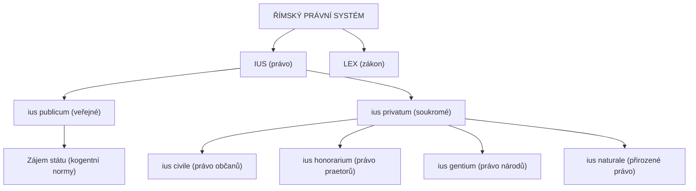

# Nadřazené téma: Pojmový systém římského práva (Ius a Lex)

## Úvod a syntéza
Římské právo vybudovalo precizní pojmový aparát, z něhož čerpá celá novodobá jurisprudence. Základem tohoto systému je rozlišování mezi **právem (*ius*)** jako širším, organickým konceptem spravedlivého řádu a **zákonem (*lex*)** jako konkrétním autoritativním předpisem, a dále zásadní členění na sféru veřejnou a soukromou.

---

## Pojmová mapa římského práva

---

## Klíčová podtémata a studijní poznámky

### 1. Rozdíl mezi Ius a Lex
- **[[ius]] (pl. *iura*):**
  - Právo v objektivním i subjektivním smyslu.
  - V pojetí Celsa: *„Ius est ars boni et aequi“* (právo je umění dobrého a spravedlivého).
  - V pozdní antice (*dominát*): označení pro souhrn děl a spisů klasických právníků.
  - V procesním smyslu: označení první fáze řízení před magistrátem (*in iure*).
- **[[lex]] (pl. *leges*):**
  - Zákon, výslovně stanovená a přijatá obecná právní norma.
  - Za republiky: usnesení lidového shromáždění na návrh úředníka (*lex publica rogata*).
  - V dominátu: výhradně označení pro císařské konstituce vydané z vůle panovníka.
  - Zásady výkladu: zákaz obcházení zákona (*in fraudem legis* – Paulus D 1, 3, 29) a teleologický výklad (*scire leges non hoc est verba earum tenere, sed vim ac potestatem* – Celsus D 1, 3, 17).

### 2. [[Ius publicum a Ius privatum]]
- **Ulpianova zájmová teorie (D 1, 1, 1, 2):**
  - *Ius publicum:* týká se postavení a prospěchu římského státu (*ad statum rei Romanae spectat*).
  - *Ius privatum:* týká se zájmů a užitku jednotlivců (*ad singulorum utilitatem spectat*).
- **Rozdíl v povaze norem:**
  - Veřejné právo je přísně **kogentní** (*Ius publicum privatorum pactis mutari non potest*).
  - Soukromé právo je převážně **dispozitivní** a stojí na smluvní autonomii vůle.

### 3. Vnitřní dělení soukromého práva
- **[[ius civile]] (právo civilní):** Přísné, formální právo římských občanů (*cives Romani*), vycházející z obyčejů, Zákona dvanácti desek a zákonů.
- **[[ius honorarium]] (právo honorární):** Pružné právo tvořené praetory, jež nepatřilo do civilního práva, ale stálo vedle něj a korigovalo jeho tvrdost na základě [[aequitas]].
- **ius gentium (právo národů):** Univerzální pravidla obchodu se zahraničními partnery, oproštěná od římského rituálního formalismu.
- **ius naturale (právo přirozené):** Pravidla daná samotnou přírodou všem živým tvorům.

---

## Propojení na další témata
- Detailní srovnání obou hlavních větví soukromého práva: viz [[Ius civile versus Ius honorarium]].
- Filozofické a interpretační fragmenty z Digest: viz [[Základní právní regule a principy v Digestech]].

---

### Související nadřazená témata
- [[00 Prameny římského práva (Rozcestník)]]
- [[Periodizace a státní zřízení Říma]]
- [[Ius civile versus Ius honorarium]]
- [[Klasická jurisprudence a její odkaz]]
