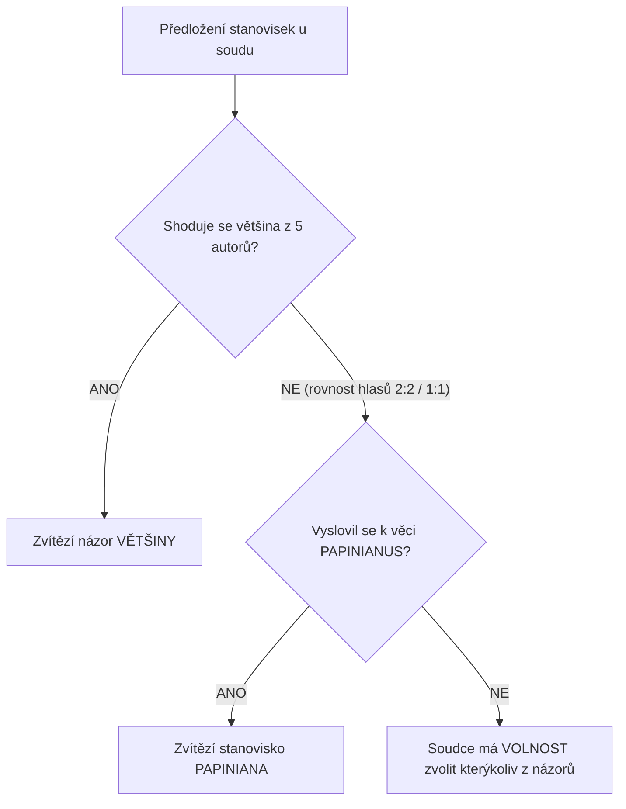

# Citační zákony (321 a 426 n. l.)

## Příčiny vzniku: Krize pozdně antické justice
V období [[dominát|dominátu]] (od konce 3. století n. l.) upadla dřívější vysoká úroveň právnického vzdělání. V soudní praxi nastal hluboký chaos:
- Strany a advokáti snášeli k soudu citace stovek knih ze spisů klasických právníků (*iura*), které si často vzájemně odporovaly.
- Docházelo k falšování textů – předkládání apokryfních a podvržených spisů vydávaných za díla slavných klasiků.
- Nezkušení byrokratičtí soudci nebyli schopni posoudit pravost ani věcnou správnost argumentů.

Panovníci se proto pokusili zavést **formální a mechanická pravidla**, která měla soudcům určit, čí názor je závazný.

---

## 1. Konstantinova konstituce (321 n. l.)
První zásah provedl císař **Konstantin Veliký**:
- Zakázal používat u soudu kritické glosy a poznámky, které **Paulus** a **Ulpianus** připsali k dílu nejslavnějšího právníka **Papiniana**.
- Cílem bylo chránit nedotknutelnou autoritu Papiniana (*auctoritas Papiniani*) před zpochybňováním.
- Později (327 n. l.) Konstantin naopak potvrdil platnost samotných samostatných Pavlových spisů (zejména *Sententiae*).

---

## 2. Citační zákon Theodosia II. a Valentiniana III. (426 n. l.)
Nejslavnější a nejvýznamnější úprava byla vydána roku **426 n. l.** v Ravenně pro západní část říše a roku 438 n. l. pojata do *Codex Theodosianus*:

### Kánon pěti závazných právníků
Zákon omezil okruh autorit, jejichž spisy směly být u soudu předkládány, na **pětici vybraných klasických autorů**:
1. **Aemilius Papinianus**
2. **Iulius Paulus**
3. **Domitius Ulpianus**
4. **Gaius** (tímto zákonem definitivně rehabilitován a postaven na roveň největším autoritám)
5. **Herennius Modestinus**

*(Kromě nich bylo dovoleno citovat i autory, na něž se tito pět přímo odvolávali – např. Iuliana, Scaevolu, Marcelluse –, pokud byla předložena spolehlivá textová srovnání rukopisů).*

---

## Mechanický rozhodovací algoritmus zákona z r. 426 n. l.

1. **Pravidlo většiny:** Pokud se právníci neshodnou, zvítězí názor, který zastává **větší počet** autorů z uvedené pětice.
2. **Pravidlo Papiniana při rovnosti hlasů:** Je-li počet hlasů nerozhodný (např. 2 proti 2, nebo 1 proti 1), má rozhodující váhu hlas **Papinianův** (jeho stanovisko automaticky převažuje).
3. **Soudcovská diskrece:** Pouze v případě, že se Papinianus k danému problému vůbec nevyjádřil a ostatní hlasy jsou rovné, může soudce svobodně zvolit kterékoliv ze zastávaných řešení.

---

## Historické zhodnocení
Citační zákon byl sice praktickým nouzovým řešením pro zmatené soudy, ale z vědeckého hlediska představoval **triumf mechanického formalismu nad tvořivým právním myšlením**. Právní spor se nerozhodoval podle kvality a hloubky argumentu, nýbrž prostým sčítáním mrtvých autorit.

Tento neuspokojivý stav překonal až o sto let později **Justinián I.**, který citační zákon zrušil a veškeré rozpory autorit autoritativně odstranil v [[Digesta|Digestech]].

---

### Související poznámky
- [[Klasická jurisprudence a její představitelé]]
- [[Dominát a absolutní monarchie]]
- [[Digesta (Pandectae) a kompilační metoda]]
- [[Interpolace v římskoprávních textech]]

### References / Zdroje
- [[Přednáška 1 - Prameny římského práva (Bělovský)]] (snímek 19)
- [[Učebnice - Římské právo (Kincl, Urfus, Skřejpek)]] (Oddíl VII, s. 37–39)
- [[Studentské výpisky - Riman prednaska 1]]
