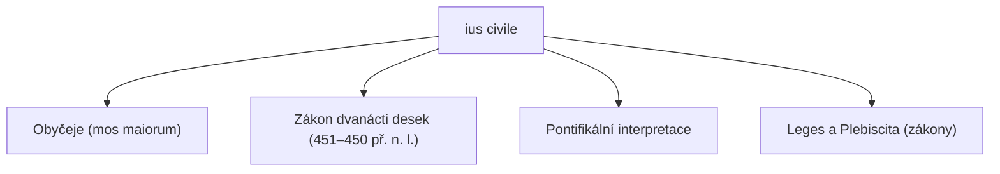

# Ius civile a jeho prameny

## Pojem a charakteristika
**Ius civile** (civilní právo, právo obce Říma – *civitas*) tvoří nejstarší kmenovou vrstvu římského právního řádu. 

### Tři základní aspekty:
1. **Právo výlučně římských občanů (*ius proprium civium Romanorum*):** Uplatňoval se starověký **princip personality práva** – římské civilní právo chránilo pouze svobodného římského občana (*civis Romanus*). Cizinec (*peregrinus*) byl z jeho ochrany vyloučen.
2. **Právo odlišné od honorárního práva:** Civilní právo stálo v protikladu k dynamickému a pružnému úřednickému právu praetorů ([[ius honorarium]]). Civilní právo bylo přísné, formalistické a konzervativní (*strictum ius*).
3. **Předchůdce moderního občanského práva:** V novodobých právních jazycích termín „civilní právo“ (francouzsky *droit civil*, německy *Zivilrecht*, česky *občanské právo*) označuje právě obecné soukromé právo.

> [!NOTE] Symbol státní moci a justice
> Výkonnou moc římských magistrátů prosazujících civilní právo a pořádek reprezentovali **liktoři (*lictores*)**, kteří před úředníky nosili **fasces** (svazky prutů se sekerami jako symbol práva trestat tělesně i hrdelně).

---

## Čtyři základní prameny iuris civilis

### 1. Obyčeje (*mos maiorum*, *consuetudo*)
- Nejstarší nepsaný pramen; pravidla zděděná po předcích a udržovaná tradicí.
- Vycházela z nich většina archaických institutů (např. bezmezná otcovská moc *patria potestas*, přísná forma sňatku *manus*, vlastnictví *dominium ex iure Quiritium*).

### 2. Zákon dvanácti desek (*Lex duodecim tabularum*, 451–450 př. n. l.)
- První písemná kodifikace římského práva, vyrytá na bronzových deskách.
- Zafixovala dosud nejisté a sporné obyčeje v zájmu plebejů.
- Stanovila přísná pravidla procesní (např. *legisactio per sacramentum*), deliktní i majetková.
- Zůstala posvátným základem civilního práva po celou dobu antického Říma.

### 3. Pontifikální interpretace (kněžský monopol)
- V rané republice měli výklad Zákona dvanácti desek a znalost žalobních formulí v rukou výhradně kněží – **pontifikové (*pontifices*)**.
- Teprve kolem roku 300 př. n. l. došlo ke zveřejnění kalendáře a formulí písařem Gnaeem Flaviem (*Ius Flavianum*) a prvnímu veřejnému vyučování práva prvním plebejským pontifikem Tiberiem Coruncaniem, čímž vznikla **laická jurisprudence**.

### 4. Zákony (*leges*) a plebiscita
- Písemné normy schválené římským lidem na shromážděních:
  - *Leges:* Shválené na *comitia centuriata* nebo *comitia tributa*.
  - *Plebiscita:* Usnesení plebejského shromáždění (*concilia plebis*), která roku 287 př. n. l. získala zákonem *Lex Hortensia* obecnou platnost pro všechny občany.

---

### Související poznámky
- [[Ius honorarium a praetorská jurisdikce]]
- [[Praetor, edikty a aequitas]]
- [[Ius civile versus Ius honorarium]]
- [[Zákon dvanácti desek]]

### References / Zdroje
- [[Přednáška 1 - Prameny římského práva (Bělovský)]] (snímky 8–9)
- [[Učebnice - Římské právo (Kincl, Urfus, Skřejpek)]] (Oddíl III, s. 14–22)
- [[Studentské výpisky - Riman prednaska 1]]
