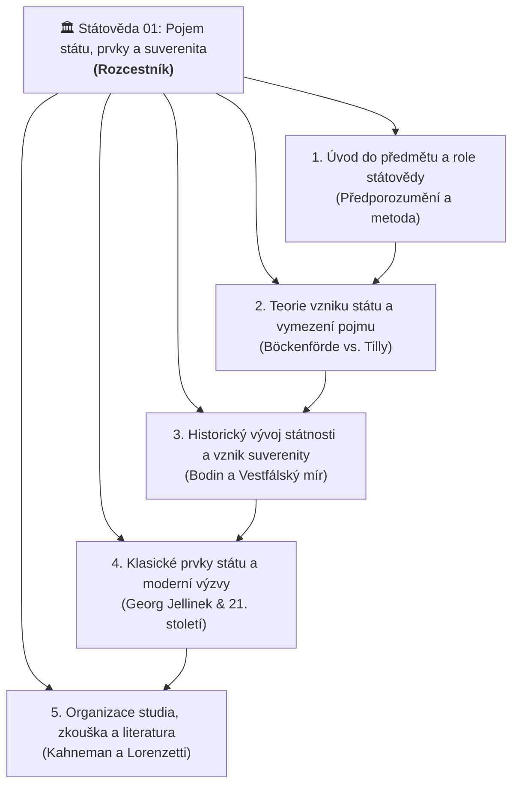

# 🏛️ Státověda 01 – Pojem státu, jeho prvky a suverenita (Rozcestník)

> [!NOTE] **Metadata přednášky**
> - **Předmět:** [[Statoveda|Státověda]] (Právnická fakulta Univerzity Karlovy)
> - **Vyučující:** [[doc. Miluše Kindlová]] (Katedra ústavního práva PF UK)
> - **Datum přednášky:** 30. 09. 2026
> - **Klíčová slova:** #statoveda #pravo #pojem-statu #jellinek #suverenita

Vítej ve studijním rozcestníku k **1. přednášce ze Státovědy** pod vedením doc. JUDr. PhDr. Miluše Kindlové, M.Jur., Ph.D.
Tento studijní systém propojuje látku z přednášky, nově připravovanou učebnici (*Kindlová a kol.*) a Tvé výpisky do přehledného a provázaného celku pro Obsidian.

---

## 🗺️ Mapa nadřazených témat (MOC)

> [!TIP] **Interaktivní navigace mezi hlavními pilíři**
> 1. 🔍 **[[Úvod do předmětu a role státovědy]]** – předporozumění, obecná část ústavního práva, normativita a empirie.
> 2. 📖 **[[Teorie vzniku státu a vymezení pojmu]]** – srovnání přísného síta (Böckenförde) a širokého síta (Tilly), 7 teorií vzniku.
> 3. ⚔️ **[[Historický vývoj státnosti a vznik suverenity]]** – boj panovníka proti církvi, císaři a městům, Jean Bodin a Vestfálský mír.
> 4. ⚖️ **[[Klasické prvky státu a moderní výzvy (Georg Jellinek)]]** – Jellinekova trojice, Montevidejská úmluva, klima, vesmír a Big Tech.
> 5. 🎓 **[[Organizace studia, zkouška a literatura]]** – Kahnemanovo rychlé a pomalé myšlení, Moodle test a esej, Alegorie dobré vlády.

---

## 📚 Přehled studijních témat a poznámek

### 1. Úvod a role státovědy pro právníky
> *„Státověda poskytuje právníkům předporozumění – základní konceptuální mřížku pro interpretaci ústavního práva.“*
- **Nadřazené téma:** [[Úvod do předmětu a role státovědy]]
- **Detailní poznámky:**
  - [[Státověda jako právní disciplína a předporozumění]] – role předporozumění, pět základních otázek státovědy (*co je stát, proč vzniká, co jej udržuje, jak zaniká, kdo má vládnout*), propojení normativity (*Sollen*) a empirie (*Sein*), interdisciplinární patchwork.
  - [[Alegorie dobré vlády (Ambrogio Lorenzetti)]] – freska v Sienské radnici (1338–1339) jako metafora cíle státovědy (spravedlnost, svornost a společné dobro vs. tyranie).

### 2. Teorie vzniku státu a náročnost definice
> *„Definice státu závisí na tom, jak přísné pojmové síto zvolíme.“*
- **Nadřazené téma:** [[Teorie vzniku státu a vymezení pojmu]]
- **Detailní poznámky:**
  - [[Ernst-Wolfgang Böckenförde vs Charles Tilly (Definice státu)]] – přísné lidskoprávní síto (Böckenförde – starověk státy nebyly) vs. široké sociologické síto (Tilly – monopol donucení, válka stvořila stát). Analýza Anny-Bettiny Kaiser.
  - [[Přehled a typologie teorií vzniku státu]] – systematický přehled 7 teoretických proudů (psychologická, teologická, mocenská, patriarchální, patrimoniální, smluvní, etická).
  - [[Smluvní teorie a společenská smlouva (Hobbes, Locke, Rousseau, Rawls)]] – přirozený stav, smlouva a typ státu u Hobbese (Leviatan), Lockea (přirozená práva a dělba moci), Rousseaua (obecná vůle) a Rawlse (závoj nevědomosti).
  - [[Teologické, patriarchální a etické koncepce státu]] – List Římanům 13, sv. Augustinus (loupežnické bandy), ústavní teokracie v Íránu; Robert Filmer (*Patriarcha*); etický cíl u Platóna, Aristotela, Kanta a Hegela.
  - [[Mocenské a patrimoniální teorie státu]] – Thrasymachos, Machiavelli, Gumplowicz, marxismus a anarchismus; stát jako majetek panovníka (Cicero, Haller) a oddělení královského fondu od fondu veřejného.

### 3. Historický vývoj státnosti a vznik suverenity
> *„Moderní stát se zrodil z vítězství panovníka nad univerzalismem církve a císaře a nad partikularismem feudálů.“*
- **Nadřazené téma:** [[Historický vývoj státnosti a vznik suverenity]]
- **Detailní poznámky:**
  - [[Historická geneze státu od neolitu po středověk]] – neolitická revoluce (zemědělství, přebytky, vládní vrstva), starověké městské státy (odosobněná moc a soudce proti krevní mstě), raně středověká lenní roztříštěnost a osobní vazby.
  - [[Boj o monopol moci a vznik moderního státu]] – panovník vs. Církev (bula *Unam Sanctam* 1302 vs. Filip IV. a Marsilius z Padovy – *Defensor Pacis*), panovník vs. Svatá říše římská (*Rex in regno suo est imperator*), panovník vs. stavové a města (stálá armáda, centrální daně).
  - [[Jean Bodin a absolutní pojetí suverenity]] – *Šest knih o státě* (1576); suverenita jako nejvyšší, trvalá, absolutní a nedělitelná moc; pravomoci a meze suveréna; posun k moderní relativní suverenitě.
  - [[Vestfálský mír a vestfálský mýtus]] – smlouvy z Münsteru a Osnabrücku (1648), suverénní rovnost, nevměšování, dekonstrukce vestfálského mýtu v moderní vědě.
  - [[Nezápadní tradice státnosti (Čína a Japonsko)]] – tisíciletá byrokratická a dynastická kontinuita v Asii od 8. stol. př. n. l., Mandát Nebes, císařství a šógunát, adaptace západního pojmu suverenity v 19. století (reformy Meidži).

### 4. Klasické prvky státu (Georg Jellinek) a výzvy 21. století
> *„Stát je svazová jednota usedlých lidí, opatřená původní mocí vládní.“*
- **Nadřazené téma:** [[Klasické prvky státu a moderní výzvy (Georg Jellinek)]]
- **Detailní poznámky:**
  - [[Jellinekova tříprvková definice státu]] – dvoustranná teorie státu (sociální fenomén vs. subjekt práva), hodnota a nadčasovost třech prvků.
  - [[Státní území, územní výsost a teritoriální integrita]] – trojrozměrný prostor (pevnina, pobřežní vody, podzemní kužel, vzdušný prostor po Kármánovu linii), [[územní výsost]] a její výjimky; klimatické zaplavení atolů (SIDS – Tuvalu, Kiribati) a [[deteritorializovaný stát]]; umělé ostrovy; nerosty na Měsíci a Lagrangeovy body.
  - [[Státní obyvatelstvo, personální výsost a občanství]] – občané, cizinci, apatridé; [[personální výsost]]; vícečetné občanství, občanství EU (čl. 20 SFEU); prodej pasů a judikatura SDEU (*Komise v. Malta* – požadavek *genuine link*); masová migrace; práva budoucích generací (BVerfG).
  - [[Státní moc, původní moc vládní a legitimní donucení (Weber)]] – schopnost prosadit vůli proti odporu; Jellinekova originární vládní moc; Max Weber a monopol na [[legitimní násilí]] (tradiční, charismatické, racionálně-právní panství); veřejná moc a samospráva; [[failed state|zhroucené státy]] (Haiti); Big Tech (Meta, SpaceX, Starlink) a AI.
  - [[Montevidejská úmluva a mezinárodní uznání (Taiwan vs Palestina)]] – čtyři znaky čl. 1 Úmluvy (1933); deklaratorní teorie (Taiwan – efektivní faktický stát) vs. konstitutivní teorie (Palestina – diplomatické uznání bez plné teritoriální moci).
  - [[Výzvy státnosti v 21. století (Klima, Vesmír, Big Tech a Failed States)]] – syntetický přehled soudobých proměn státnosti pro zkouškovou esej.

### 5. Organizace studia a zkouška
> *„Zkouška kombinuje rychlé ověření základních kategorií s pomalou analytickou syntézou v eseji.“*
- **Nadřazené téma:** [[Organizace studia, zkouška a literatura]]
- **Detailní poznámky:**
  - [[Zkouška ze státovědy a systém hodnocení (Kahneman)]] – Kahnemanův model (rychlé myšlení: Moodle test 12 otázek, 1 b za celou správnou odpověď; pomalé myšlení: esej výběrem 2 z 8 okruhů s literaturou a judikaturou).
  - [[Alegorie dobré vlády (Ambrogio Lorenzetti)]] – etický a institucionální rozměr dobrého vládnutí.

---

## 🔑 Rychlý rejstřík klíčových pojmů (Keys)
- **Základní pojmy státovědy:** [[státověda]], [[předporozumění]], [[suverenita]], [[společenská smlouva]], [[legitimní násilí]]
- **Jellinekovy prvky a výsosti:** [[státní území]], [[státní obyvatelstvo]], [[státní moc]], [[územní výsost]], [[personální výsost]]
- **Teoretici a prameny:** [[Georg Jellinek]], [[Jean Bodin]], [[Montevidejská úmluva]], [[vestfálský mír]]
- **Moderní výzvy:** [[deteritorializovaný stát]], [[failed state]]

---

## 📖 Primární zdroje
- [[Přednáška 1 - Úvod do státovědy (Kindlová)]] – podrobná zdrojová karta přednášky (30. 9. 2026)
- [[Učebnice - Státověda (Kindlová a kol.)]] – základní učebnice (2. vydání, říjen 2026)
- [[Studentské výpisky - Statoveda prednaska 1]] – původní studentské poznámky
- [[Statoveda]] – původní základní souhrn ve vaultu
