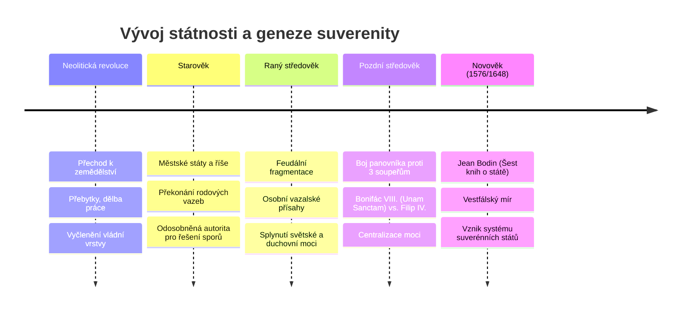

# Nadřazené téma: Historický vývoj státnosti a vznik suverenity

## Úvod a syntéza
Stát v podobě, v jaké jej známe dnes – jako centralizovaný teritoriální útvar nadaný monopolem zákonodárné a donucovací moci –, nebyl samozřejmostí. Je výsledkem tisícileté historické evoluce.

Zatímco starověk položil základy odosobněné veřejné moci a raný středověk byl charakterizován feudální roztříštěností a osobními vazbami, moderní stát se zrodil ve vrcholném a pozdním středověku. V tomto období musel panovník vybojovat monopol moci proti třem mocným konkurentům:
1. **Univerzální církvi** (reprezentované papežem),
2. **Svaté říši římské** (reprezentované císařem),
3. **Vnitřním partikulárním silám** (feudální šlechtě a autonomním městům).

Teoretickým vyústěním tohoto boje byla formulace konceptu **[[suverenita|suverenity]]** francouzským právníkem **[[Jean Bodin|Jeanem Bodinem]]** (1576) a mezinárodní ukotvení skrze **[[vestfálský mír]] (1648)**.

---

## Časová osa vývoje státnosti

---

## Klíčová podtémata a studijní poznámky

### 1. [[Historická geneze státu od neolitu po středověk]]
- Neolitická revoluce: materiální předpoklady státnosti (usedlý život, akumulace majetku, obrana sýpek a polí).
- Starověké útvary: Mezopotámie, Egypt, řecká *polis*, Římská říše. Vznik nestranné soudní instance pro překonání krevní msty.
- Raný středověk: Absence abstraktního státu; vláda vázaná na fyzickou osobu krále a lenní smlouvy.

### 2. [[Boj o monopol moci a vznik moderního státu]]
- **Panovník vs. Církev:** Papež Bonifác VIII. a bula *Unam Sanctam* (1302) o nadřazenosti duchovního meče nad světským. Odpor francouzského krále Filipa IV. Sličného. Filosofická obhajoba suverenity světského státu: **Marsilius z Padovy** (*Defensor Pacis*, 1324).
- **Panovník vs. Svatá říše římská:** Odmítnutí svrchovanosti císaře národními králi (*„Rex in regno suo est imperator“* – král je ve svém království císařem).
- **Panovník vs. Feudálové a města:** Překonání stavovského partikularismu, zavedení stálé královské armády a centrální daňové správy.

### 3. [[Jean Bodin a absolutní pojetí suverenity]]
- Historický kontext: náboženské války ve Francii a potřeba neotřesitelné královské moci.
- *Šest knih o státě* (1576): vymezení suverenity jako nejvyšší, trvalé, absolutní a nedělitelné moci.
- Výlučné kompetence suveréna a meze suverenity (zákony Boží a přirozené).
- Srovnání: absolutní suverenita Bodinova vs. **moderní relativní suverenita** (členství v EU, mezinárodní úmluvy o lidských právech).

### 4. [[Vestfálský mír a vestfálský mýtus]]
- Mírové dohody z Münsteru a Osnabrücku (1648) a konec třicetileté války.
- Princip suverénní rovnosti a zákaz vměšování (*cuius regio, eius religio*).
- Teorie „Vestfálského mýtu“: moderní kritika přeceňování roku 1648 jako náhlého zrodu suverenity.

### 5. [[Nezápadní tradice státnosti (Čína a Japonsko)]]
- Komparace se západním modelem: Čína a Japonsko vybudovaly centralizovanou byrokratickou správu a stabilní říše již od 8. století př. n. l.
- Specifika: absence plurality církve a státu, dynastická kontinuita, Mandát Nebes.
- V 19. století (např. reformy Meidži v Japonsku) adaptovaly západní koncept pozitivní suverenity do své tisícileté tradice.

---

## Shrnutí k zapamatování pro zkoušku
- Vznik moderního státu = vítězství panovníka nad **církví**, **císařem** a **feudály**.
- Bula *Unam Sanctam* (1302) vs. Marsilius z Padovy (*Defensor Pacis*).
- **Jean Bodin (1576):** Zakladatel konceptu **suverenity** (nejvyšší, nedělitelná moc).
- **Vestfálský mír (1648):** Považován za počátek mezinárodního práva a systému suverénních států.
- Nezápadní státy (Čína, Japonsko) měly silnou centralizovanou státnost nezávisle na Západě.

---

### Související nadřazená témata
- [[00 Státověda 01 - Pojem státu, jeho prvky a suverenita (Rozcestník)]]
- [[Úvod do předmětu a role státovědy]]
- [[Teorie vzniku státu a vymezení pojmu]]
- [[Klasické prvky státu a moderní výzvy (Georg Jellinek)]]
