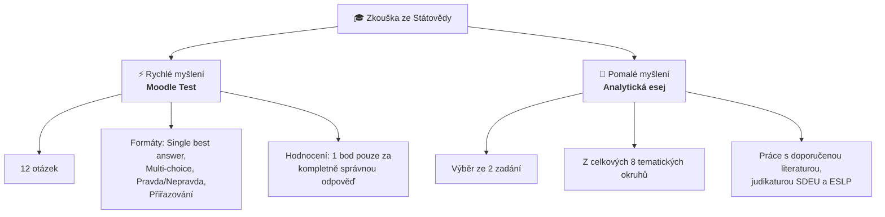

# Nadřazené téma: Organizace studia, zkouška a literatura

## Úvod a koncepce zkoušky
Předmět **Státověda** na Právnické fakultě Univerzity Karlovy vede Katedra ústavního práva pod garancí **[[doc. Miluše Kindlová|doc. JUDr. PhDr. Miluše Kindlové, M.Jur., Ph.D.]]**

Zkouška je koncipována s odkazem na kognitivní teorii psychologa a nobelisty **Daniela Kahnemana** (*Myšlení: Rychlé a pomalé*):
1. **Rychlé myšlení (Systém 1 / automatické vybavení znalostí):** Moodle test ověřující základní fakta, pojmy, definice a klasifikace.
2. **Pomalé myšlení (Systém 2 / analytická a kritická syntéza):** Písemná esej vyžadující hlubokou argumentaci, schopnost komparace a práci s doporučenou literaturou a judikaturou.

---

## Struktura zkouškového hodnocení

---

## Klíčová podtémata a studijní poznámky

### 1. [[Zkouška ze státovědy a systém hodnocení (Kahneman)]]
- Podrobná metodika přípravy na Moodle test: typy úloh, chytáky v definicích, bodovací kritéria.
- Metodika psaní státovědné eseje: struktura argumentu, práce s teoretickými koncepty, komparace autorů.
- Přehled 8 tematických okruhů pro esej.

### 2. [[Alegorie dobré vlády (Ambrogio Lorenzetti)]]
- Symbolické poselství přednášky: freska v Sienské radnici (1338–1339) jako metafora cíle studia státovědy.
- Hledání pravidel a institucí pro spravedlivý a prosperující společenský řád.

---

## Studijní literatura a prameny

### Povinná a doporučená literatura
1. **Základní učebnice:**
   - Kindlová, M. a kol.: *Státověda*. 2. přepracované vydání, Praha: Katedra ústavního práva PF UK (očekáváno cca polovina října 2026).
2. **Klíčová judikatura (povinná četba k přednáškám a esejím):**
   - **Soudní dvůr Evropské unie (SDEU):**
     - Věc *Evropská komise v. Maltská republika* – problematika zcizení a prodeje státního občanství v rozporu se zásadou loajální spolupráce a požadavkem reálného pouta (*genuine link*).
   - **Evropský soud pro lidská práva (ESLP):**
     - Vybrané rozsudky k ochraně základních práv, demokratickému procesu a hranicím státní moci.

---

### Související nadřazená témata
- [[00 Státověda 01 - Pojem státu, jeho prvky a suverenita (Rozcestník)]]
- [[Úvod do předmětu a role státovědy]]
- [[Teorie vzniku státu a vymezení pojmu]]
- [[Historický vývoj státnosti a vznik suverenity]]
- [[Klasické prvky státu a moderní výzvy (Georg Jellinek)]]
