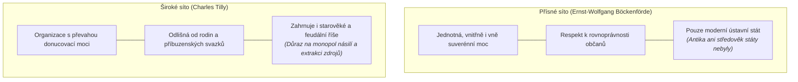

# Nadřazené téma: Teorie vzniku státu a vymezení pojmu

## Úvod a syntéza
Definovat stát je jedním z nejnáročnějších úkolů právní a politické filozofie. Záleží totiž na tom, jaké **„síto“ (požadavky)** na pojem státu položíme:
- Zda zvolíme přísné lidskoprávní pojetí (podle kterého je státem až moderní ústavní útvar zaručující rovnost občanů),
- nebo široké sociologické síto (které za stát považuje jakoukoli organizaci disponující převahou donucovací moci nad daným teritoriem).

Spolu s definicí státu vyvstává otázka po jeho původu a účelu: *Zda je stát dílem Božím, přirozeným vývojem rodiny, výsledkem násilného podmanění, racionální společenskou smlouvou, či etickým nástrojem mravního zdokonalení.*

---

## Porovnání definičních přístupů (Böckenförde vs. Tilly)

---

## Klíčová podtémata a studijní poznámky

### 1. [[Ernst-Wolfgang Böckenförde vs Charles Tilly (Definice státu)]]
- Podrobný rozbor německé státovědné debaty (včetně rozboru [[Anna-Bettina Kaiser]]).
- Důsledky přísného vs. širokého síta pro právní dějiny a srovnávací ústavní právo.

### 2. [[Přehled a typologie teorií vzniku státu]]
- Ucelená typologie 7 základních teoretických proudů:
  1. **Psychologická / antropologická:** Přirozený společenský pud člověka (*zoon politikon*).
  2. **Teologická:** Boží vůle k zamezení hříšného chaosu (*List Římanům 13,1*).
  3. **Mocenská:** Nadvláda a podmanění slabších silnějšími / třídní útlak.
  4. **Patriarchální:** Přirozený přechod z rodiny a rodu; panovník jako otec (*Robert Filmer*).
  5. **Patrimoniální:** Stát jako soukromoprávní majetek panovníka (*K. L. von Haller*).
  6. **Smluvní (kontraktuální):** Vědomá dohoda svobodných jednotlivců k ochraně bezpečí a práv.
  7. **Etická:** Nástroj kultivace ctnosti a dobra (*Platón, Aristotelés, Hegel*).

### 3. [[Smluvní teorie a společenská smlouva (Hobbes, Locke, Rousseau, Rawls)]]
- Komparace přirozeného stavu, důvodu uzavření smlouvy a typu státu u Thomase Hobbese, Johna Lockea a Jeana-Jacquese Rousseaua.
- Moderní kontraktualismus Johna Rawlse (teorie spravedlnosti a závoj nevědomosti).

### 4. [[Teologické, patriarchální a etické koncepce státu]]
- Augustinus Aurelius (*O Boží obci*) a křesťanské pojetí státní moci. Moderní ústavní teokracie (Írán).
- Patriarchální model Roberta Filmera (*Patriarcha*) a jeho kritika Lockem.
- Etický cíl státu: od Platónovy *Ústavy* po Hegelovo pojetí státu jako uskutečnění mravní ideje.

### 5. [[Mocenské a patrimoniální teorie státu]]
- Násilná teorie vzniku státu (L. Gumplowicz, F. Oppenheimer, marxismus, anarchismus).
- Niccolò Machiavelli (*Vladař*) a pragmatismus moci.
- Patrimoniální chápání státu (Cicero, Haller) a historické nesplývání státní a soukromé pokladny ve středověku.

---

## Shrnutí k zapamatování pro zkoušku
- **Böckenförde:** Státem je až moderní útvar respektující rovnost; starověké obce státy nebyly.
- **Tilly:** Státem je jakákoli teritoriální organizace s monopolem donucení (i historické říše).
- **Základní teorie vzniku:** Teologická (Bůh), Patriarchální (rodina), Patrimoniální (majetek), Mocenská (násilí), Smluvní (konsenzus), Etická (dobro).
- **Smluvní teorie** je fundamentem moderní ústavnosti a základních lidských práv.

---

### Související nadřazená témata
- [[00 Státověda 01 - Pojem státu, jeho prvky a suverenita (Rozcestník)]]
- [[Úvod do předmětu a role státovědy]]
- [[Historický vývoj státnosti a vznik suverenity]]
- [[Klasické prvky státu a moderní výzvy (Georg Jellinek)]]
