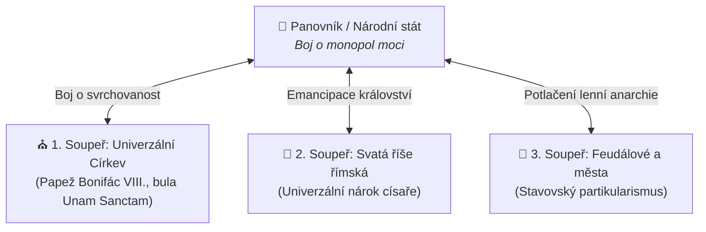

# Boj o monopol moci a vznik moderního státu

## 1. Zrod moderního státu ve vrcholném a pozdním středověku
Vznik moderního centralizovaného státu nebyl poklidným procesem. Šlo o staletý dramatický zápas, v němž musel panovník (monarcha) postupně vybojovat **monopol zákonodárné, soudní a vojenské moci proti třem mocenským soupeřům**:

---

## 2. První soupeř: Univerzální Církev a papežství
Ve středověku si římští papežové nárokovali absolutní nadřazenost nad všemi světskými vládci na základě teorie dvou mečů (duchovního a světského).
- **Papež Bonifác VIII. a bula *Unam Sanctam* (1302):**
  - Vrchol papežského teokratického univerzalismu.
  - Tvrzení: Církvi náleží oba meče. Světský meč má být tasen pro církev králi a vojáky, ale na pokyn a pod kontrolou kněze.
  - Závěr buly: Podřízenost římskému papeži je pro každého člověka naprosto nezbytná ke spáse.
- **Konflikt s Filipem IV. Sličným (Francie):**
  - Francouzský král odmítl papežovy nároky na zdanění kléru i zásahy do královské jurisdikce. Filipovi rádci (legisté) prosadili zásadu, že král nepodléhá nikomu na světě. Následovalo zajetí papeže v Anagni (1303) a avignonské zajetí papežů.
- **Marsilius z Padovy a spis *Defensor Pacis* (Obránce míru, 1324):**
  - Zásadní teoretický přelom: Marsilius obhájil autonomii a suverenitu světské moci.
  - Zdrojem moci ve státě je lid (*legislator humanus*). Církev nemá mít žádnou světskou donucovací pravomoc ani jurisdikci; kněží mají sloužit pouze duchovní útěše.

---

## 3. Druhý soupeř: Svatá říše římská a císařství
Císař Svaté říše římské si nárokoval postavení nejvyšší hlavy celého západního křesťanstva a nástupce římských císařů.
- Národní monarchie (Francie, Anglie, Kastilie) tento nárok kategoricky odmítly.
- Právní formule legistů:
  > *„Rex in regno suo est imperator regni sui“* (Král je ve svém království císařem).
- Tím byla deklarována vnější nezávislost teritoriálního království na jakékoli nadnárodní světské autoritě.

---

## 4. Třetí soupeř: Feudální šlechta a autonomní města
Uvnitř státu čelil král roztříštěné moci feudálů, kteří disponovali vlastními soukromými vojsky, vybírali mýta a vykonávali hrdelní právo na svých panstvích.
- **Zavedení stálé královské armády:** Panovník nahradil nespolehlivou feudální hotovost profesionálním žoldnéřským vojskem placeným z královské pokladny.
- **Centrální daňový systém:** Výběr stálých daní namísto nahodilých lenních příspěvků.
- **Monopol na soudnictví:** Zřízení královských odvolacích soudů a potlačení soukromých válek a krevní msty mezi šlechtici.

Výsledkem tohoto trojího vítězství byl **suverénní, centralizovaný teritoriální stát**.

---

### Související poznámky
- [[Historický vývoj státnosti a vznik suverenity]]
- [[Jean Bodin a absolutní pojetí suverenity]]
- [[Vestfálský mír a vestfálský mýtus]]

### References / Zdroje
- [[Přednáška 1 - Úvod do státovědy (Kindlová)]] (blok 3)
- [[Učebnice - Státověda (Kindlová a kol.)]]
