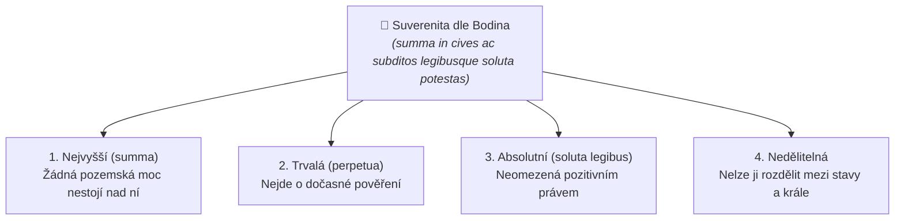

# Jean Bodin a absolutní pojetí suverenity

## 1. Kdo byl Jean Bodin a historický kontext
Francouzský právník, filozof a člen pařížského parlamentu **[[Jean Bodin]]** (1530–1596) formuloval moderní teorii suverenity v reakci na hlubokou krizi francouzského království. Francie byla v 16. století devastována krutými náboženskými válkami mezi katolíky a protestantskými hugenoty (Bartolomějská noc 1572).

Bodin patřil do myšlenkového proudu tzv. *politiques* (státníků), kteří tvrdili, že jediným způsobem, jak zabránit sebezničení společnosti a chaosu, je **vybudování silné, centralizované královské moci stojící nad náboženskými spory**.

---

## 2. Šest knih o státě (1576): Zrod suverenity
Ve svém monumentálním díle *Les Six Livres de la République* (1576) definoval stát (*république*) takto:
> *„Stát je zákonná vláda nad větším počtem rodin a nad tím, co je jim společné, se suverénní mocí.“*

### Definice suverenity podle Bodina:
Suverenita (*souveraineté*) je **nejvyšší, trvalá, absolutní a nedělitelná moc** nad občany a poddanými ve státě.

---

## 3. Znaky a kompetence suveréna
Podle Bodina disponuje suverén souborem výlučných pravomocí, které nelze přenést na nikoho jiného:
1. **Zákonodárný monopol:** Právo dávat zákony všem poddaným obecně i jednotlivě, aniž by k tomu potřeboval souhlas kohokoli jiného (*legibus solutus* – panovník není vázán zákony svých předchůdců ani svými vlastními).
2. **Vyhlašování války a uzavírání míru.**
3. **Jmenování nejvyšších úředníků a soudců.**
4. **Nejvyšší soudní instance:** Právo konečného odvolání a udělování milosti.
5. **Výběr daní a ražba mincí.**

---

## 4. Byla Bodinova suverenita skutečně bezbřehá?
Ačkoliv Bodin označuje suverenitu za absolutní, **nejde o svévoli ani tyranii**. Suverén je podle Bodina vázán:
- **Zákony Božími a přirozenými (*leges divinae et naturales*):** Panovník nesmí svévolně popravovat nevinné lidi, zotročovat poddané ani porušovat daná slova.
- **Základními zákony království (*leges imperii*):** Např. ve Francii salický zákon (nástupnictví pouze v mužské linii) a nezcizitelnost královské domény.
- **Respektem k rodině a soukromému vlastnictví:** Suverén nesmí svévolně zabavit majetek poddaného bez zákonného důvodu.

---

## 5. Srovnání: Absolutní suverenita (Bodin) vs. Relativní suverenita (21. století)

| Kritérium | Absolutní suverenita (Jean Bodin) | Relativní suverenita (21. století) |
| :--- | :--- | :--- |
| **Nositel moci** | Monarcha / král | Lid (občané) jako suverén |
| **Vázanost právem** | Stojí nad pozitivním právem (*legibus solutus*) | Vázán ústavou, zákony a mezinárodními závazky |
| **Dělitelnost moci** | Přísně nedělitelná v jediném centru | Dělba moci (zákonodárná, výkonná, soudní) |
| **Mezinárodní rámec** | Žádné mezinárodní soudy ani unie | Členství v EU, podřízení judikatuře SDEU a ESLP |

---

### Související poznámky
- [[Historický vývoj státnosti a vznik suverenity]]
- [[Boj o monopol moci a vznik moderního státu]]
- [[Vestfálský mír a vestfálský mýtus]]
- [[Státní moc, původní moc vládní a legitimní donucení (Weber)]]

### References / Zdroje
- [[Přednáška 1 - Úvod do státovědy (Kindlová)]] (blok 3)
- [[Učebnice - Státověda (Kindlová a kol.)]]
