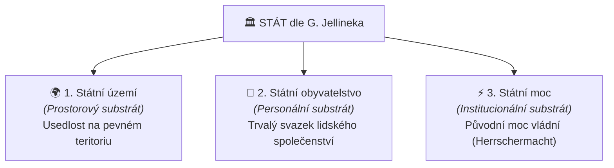

# Jellinekova tříprvková definice státu

## 1. Georg Jellinek a Všeobecná státověda (1900)
Profesor **[[Georg Jellinek]]** (1851–1911) vytvořil ve své knize *Allgemeine Staatslehre* konceptuální model, který dodnes tvoří základ ústavního a mezinárodního práva.

### Definice státu:
> *„Stát je svazová jednota usedlých lidí, opatřená původní mocí vládní.“*
> *(Der Staat ist die mit ursprünglicher Herrschermacht ausgerüstete Verbandseinheit seßhafter Menschen.)*

---

## 2. Dvojí tvář státu (Dvoustranná teorie)
Jellinek geniálně překonal spor mezi sociologií a právní vědou tím, že stát definoval jako entitu se dvěma neoddělitelnými stránkami:
1. **Sociální stránka státu:**
   - Stát jako empirická sociální realita.
   - Společenství reálných lidí, vzájemné sociální a mocenské vztahy, loajalita obyvatel a faktická dominance.
2. **Právní stránka státu:**
   - Stát jako **subjekt práva** (právnická osoba veřejného práva, korporace).
   - Nosič práv a povinností, instituce nadaná právní osobností a suverénní originární pravomocí.

---

## 3. Tři konstitutivní prvky státu (*Drei-Elemente-Lehre*)
Aby mohl jakýkoli mocenský útvar existovat jako stát, musí kumulativně vykazovat tři základní prvky:

1. **[[státní území]]:** Teritoriální vymezení, na němž stát trvale existuje a vykonává svou [[územní výsost]]. Kočovné kmeny bez teritoria státem nejsou.
2. **[[státní obyvatelstvo]]:** Personální substrát spojený se státem trvalým poutem občanství, nad nímž stát vykonává svou [[personální výsost]].
3. **[[státní moc]]:** Původní (originární), vrchnostenská a nezávislá vládní moc, která si vynucuje poslušnost a tvoří právní řád.

---

## 4. Proč je Jellinekova definice tak úspěšná a trvalá?
1. **Hodnotová neutralita:** Definice nepředepisuje státu, zda musí být demokracií, monarchií či diktaturou. Popisuje konstitutivní minimum existence státu.
2. **Časová odolnost:** Funguje v 19. i 21. století.
3. **Dogmatická preciznost:** Zabraňuje záměně státu za pouhou vládu, ideologii nebo rasu.

---

### Související poznámky
- [[Klasické prvky státu a moderní výzvy (Georg Jellinek)]]
- [[Státní území, územní výsost a teritoriální integrita]]
- [[Státní obyvatelstvo, personální výsost a občanství]]
- [[Státní moc, původní moc vládní a legitimní donucení (Weber)]]
- [[Montevidejská úmluva a mezinárodní uznání (Taiwan vs Palestina)]]

### References / Zdroje
- [[Přednáška 1 - Úvod do státovědy (Kindlová)]] (blok 4)
- [[Učebnice - Státověda (Kindlová a kol.)]]
