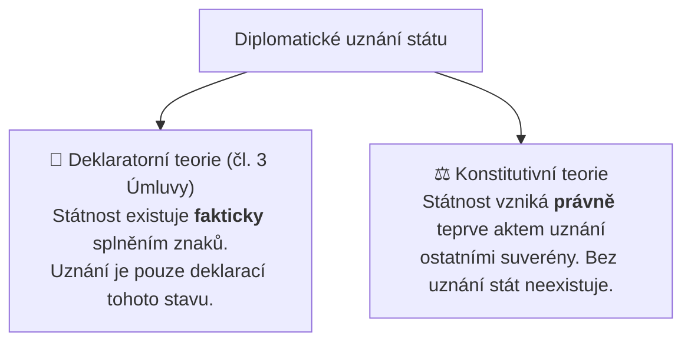

# Montevidejská úmluva a mezinárodní uznání (Taiwan vs Palestina)

## 1. Montevidejská úmluva (1933) a čtvrtý prvek státnosti
Úmluva o právech a povinnostech států přijatá v Montevideu v roce 1933 představuje klíčový mezinárodněprávní dokument definující státnost.

### Čtyři definiční znaky (čl. 1 Úmluvy):
1. **Stálé obyvatelstvo** (*a permanent population*).
2. **Vymezené území** (*a defined territory*).
3. **Vláda** (*government* – efektivní výkon veřejné moci).
4. **Způsobilost vstupovat do vztahů s jinými státy** (*capacity to enter into relations with other states*).

Zatímco první tři znaky odpovídají [[Georg Jellinek|Jellinekově]] klasické trojici, čtvrtý znak výslovně zdůrazňuje **vnější mezinárodněprávní způsobilost**.

---

## 2. Dvě teorie mezinárodního uznání státu
Vyvstává zásadní otázka: *Stává se entita státem teprve tím, že ji uznají ostatní státy, nebo existuje jako stát nezávisle na jejich vůli?*

- **Deklaratorní teorie (převládající doktrína, potvrzená čl. 3 Montevidejské úmluvy):**
  - *„Politická existence státu je nezávislá na uznání ostatními státy.“*
  - Pokud útvar reálně ovládá území, má stálé obyvatelstvo a efektivní vládu, je státem *ipso facto*. Uznání má pouze politický a deklaratorní charakter.
- **Konstitutivní teorie (tradiční pozitivismus 19. století):**
  - Stát nemůže nabýt mezinárodněprávní subjektivity bez právního aktu uznání ze strany existujících členů mezinárodního společenství.

---

## 3. Případové studie: Taiwan vs. Palestina
Napětí mezi deklaratorní a konstitutivní teorií ilustrují dva moderní případy:

| Kritérium | Taiwan (Čínská republika) | Palestina (Stát Palestina) |
| :--- | :--- | :--- |
| **Stálé obyvatelstvo** | ANO (cca 23,5 milionu lidí) | ANO (cca 5 milionů na Západním břehu a v Gaze) |
| **Vymezené území** | ANO (ostrov Taiwan a přilehlé ostrovy) | SPORNÉ (území pod izraelskou okupací / rozdělené) |
| **Efektivní vláda** | **PLNÁ** (demokratické volby, soudy, policie, armáda, měna, daně) | **DEFICITNÍ** (vnitřní rozštěpení, absence plné kontroly nad hranicemi) |
| **Mezinárodní uznání** | **VELMI NÍZKÉ** (oficiálně jen cca 12 států z důvodu tlaku ČLR a politiky jedné Číny) | **VELMI VYSOKÉ** (uznána více než 145 státy světa, status pozorovatelského státu v OSN) |
| **Výsledek pro státovědu** | **Faktický stát (*de facto state*)** s plnou interní státností, ale omezeným vnějším diplomatickým statutem. | **Diplomaticky uznaný stát**, kterému však chybí plná faktická efektivita moci nad územím. |

---

### Související poznámky
- [[Klasické prvky státu a moderní výzvy (Georg Jellinek)]]
- [[Jellinekova tříprvková definice státu]]
- [[Státní území, územní výsost a teritoriální integrita]]
- [[Státní moc, původní moc vládní a legitimní donucení (Weber)]]

### References / Zdroje
- [[Přednáška 1 - Úvod do státovědy (Kindlová)]] (blok 4)
- [[Učebnice - Státověda (Kindlová a kol.)]]
