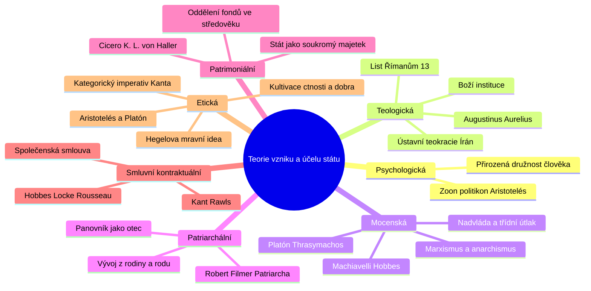

# Přehled a typologie teorií vzniku státu

V dějinách právního a filozofického myšlení vznikla celá řada modelů vysvětlujících, proč se lidé organizují do vrchnostenské jednotky zvané stát. Lektorka doc. Miluše Kindlová rozlišuje sedm základních teoretických proudů:

---

## Sedm základních teorií státu

### 1. Psychologická / antropologická teorie
- **Myšlenka:** Stát je přirozeným vyústěním lidské psychiky a instinktu družit se. Člověk je od přírody tvor společenský a politický (**zoon politikon** dle Aristotela).
- Mimo společnost může žít pouze bůh, nebo zvíře. Samota vede k degradaci osobnosti; stát poskytuje rámec pro rozvoj řeči, myšlení a spolupráce.

### 2. Teologická teorie
- **Myšlenka:** Stát a vládní moc jsou Bohem zřízené instituce. Po prvotním hříchu je lidská přirozenost zkažená a bez autority by nastal sebezničující chaos.
- **Biblický základ:** *List apoštola Pavla Římanům 13,1–2*: *„Každý ať se podřizuje vrchnosti, neboť není vrchnosti než od Boha. Kdo se staví proti vrchnosti, vzpírá se Božímu řádu.“*
- Představitelé: **sv. Augustinus Aurelius** (*De civitate Dei*), Tomáš Akvinský.
- Moderní přesah: Ústavní teokracie (např. Islámská republika Írán, kde má náboženský vůdce a rada dohlížitelů přednost před volenými orgány).

### 3. Mocenská teorie
- **Myšlenka:** Stát vznikl násilím – podmaněním slabších silnějšími a udržením této nadvlády. Spravedlnost je pouze zájmem silnějšího (sofista Thrasymachos v Platónově *Ústavě*).
- Představitelé: Niccolò Machiavelli, Thomas Hobbes (přirozený stav jako boj), Ludwig Gumplowicz, Franz Oppenheimer.
- Radikální vyústění:
  - **Marxismus:** Stát je nástrojem vládnoucí třídy k vykořisťování a potlačování proletariátu; po dosažení beztřídní společnosti musí odumřít.
  - **Anarchismus:** Stát je organizované zlo a násilí, které musí být zrušeno pro dosažení autentické lidské svobody.

### 4. Patriarchální teorie
- **Myšlenka:** Stát je organickým rozšířením přirozené rodiny a klanu. Panovník má vůči poddaným stejné postavení a práva jako otec rodiny (*pater familias*) vůči dětem.
- Představitel: **Robert Filmer** (*Patriarcha*, 1680) – absolutní moc králů odvozoval přímo od otcovské moci biblického Adama.
- Odpůrci: John Locke ve *Dvou pojednáních o vládě* tuto koncepci zásadně vyvrátil s poukazem na to, že občané nejsou nesvéprávné děti a moc krále není otcovskou péčí.

### 5. Patrimoniální teorie
- **Myšlenka:** Stát je vnímán jako soukromoprávní majetek panovníka (lat. *patrimonium* = dědičný rodinný majetek). Panovník vládne nad územím a lidmi proto, že mu patří jako vlastnictví.
- Představitelé: Cicero (první reflexe), Karl Ludwig von Haller (*Restauration der Staatswissenschaft*, 1816).
- Historická praxe: Ve vrcholném středověku se postupně začal oddělovat soukromý fond krále (*fiscus*) od veřejného majetku koruny (tzv. fiskální dualismus).

### 6. Smluvní (kontraktuální) teorie
- **Myšlenka:** Stát je produktem racionální dohody svobodných jednotlivců – **společenské smlouvy**. Lidé opouštějí nejistý přirozený stav a svěřují moc autoritě za účelem garance míru, bezpečí a ochrany práv.
- Představitelé: Richard Hooker, Thomas Hobbes, John Locke, Jean-Jacques Rousseau, Immanuel Kant, John Rawls.
- Tvoří ideový fundament moderní konstituční demokracie a lidských práv.

### 7. Etická teorie
- **Myšlenka:** Stát není pouhým technickým hlídačem bezpečnosti ani majetkem, ale nástrojem mravního zdokonalení člověka a naplnění nejvyšší ideje dobra.
- Představitelé:
  - **Platón & Aristotelés:** Cílem státu je ctnost (*areté*) a dobrý život (*eu zén*).
  - **Immanuel Kant:** Stát jako nutný rámec pro realizaci kategorického imperativu a vnější svobody v souladu se svobodou ostatních.
  - **G. W. Hegel:** Stát je uskutečněním mravní ideje na zemi (*„pochod Boha světem“*), vrcholem objektivního ducha.

---

### Související poznámky
- [[Teorie vzniku státu a vymezení pojmu]]
- [[Smluvní teorie a společenská smlouva (Hobbes, Locke, Rousseau, Rawls)]]
- [[Teologické, patriarchální a etické koncepce státu]]
- [[Mocenské a patrimoniální teorie státu]]

### References / Zdroje
- [[Přednáška 1 - Úvod do státovědy (Kindlová)]] (blok 2)
- [[Učebnice - Státověda (Kindlová a kol.)]]
