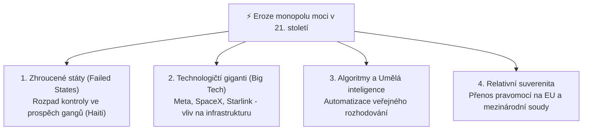

# Státní moc, původní moc vládní a legitimní donucení (Weber)

## 1. Definice státní moci
V obecné státovědě je moc chápána jako **schopnost prosadit svou vůli a ovlivnit chování jiných i proti jejich případnému odporu** (Filip, Svatoň).
**[[státní moc]]** je specifickým druhem společenské moci, která se odlišuje svou autoritou, dosahem a donucovacím aparátem.

---

## 2. Dva teoretické pilíře: Jellinek a Weber

### A. Původní moc vládní (Georg Jellinek)
Podle **[[Georg Jellinek|Georga Jellineka]]** se státní moc vyznačuje tím, že je:
- **Originární (původní – *ursprünglich*):** Nevyvozuje svou platnost z žádné vyšší pozemské moci. Je svrchovaná a vládne z vlastního právního titulu.
- **Vládnoucí (*Herrschermacht*):** Disponuje způsobilostí vydávat bezpodmínečně závazné příkazy a zákazy a tyto příkazy donucením vynucovat.

### B. Monopol na legitimní fyzické násilí (Max Weber)
Sociolog **Max Weber** (1864–1920) ve své slavné přednášce *Politika jako povolání* (1919) formuloval klíčový postulát:
> *„Stát je lidské společenství, které si na určitém teritoriu – a to je jeho znakem – s úspěchem osobuje monopol legitimního fyzického donucení.“*

- **Monopol:** Soukromé osoby nesmějí užívat fyzické násilí (výjimkou jsou pouze státem přesně vymezené instituty nutné obrany a krajní nouze).
- **Legitimita:** Obyvatelstvo přijímá výkon moci jako oprávněný. Weber rozlišil tři čisté typy legitimního panství:
  1. *Tradiční panství:* Založené na posvátnosti odvěkých tradic a zvyků (patriarcha, feudální pán).
  2. *Charismatické panství:* Založené na oddanosti výjimečným osobním vlastnostem vůdce (prorok, vojevůdce, demagog).
  3. *Racionálně-právní panství:* Založené na víře v legalitu neosobních, formálně správně přijatých pravidel a zákonů (moderní ústavní a byrokratický stát).

---

## 3. Státní moc vs. Veřejná moc
V českém a evropském ústavním právu je nutné rozlišovat dva pojmy:
- **Státní moc (v užším smyslu):** Moc vykonávaná přímo orgány státu (prezident, vláda, ministerstva, parlament, soudy, policie, armáda).
- **Veřejná moc (v širším smyslu):** Zahrnuje státní moc **plus decentralizovanou moc**, kterou stát delegoval na ne-státní subjekty:
  - *Územní samospráva:* Obce a kraje (vydávají obecně závazné vyhlášky a hospodaří s vlastním majetkem).
  - *Zájmová a profesní samospráva:* Profesní komory s nuceným členstvím (Česká advokátní komora, Česká lékařská komora), které vykonávají disciplinární pravomoc nad svými členy.

---

## 4. Výzvy 21. století: Eroze a konkurenti státní moci

### A. Zhroucené státy (*failed states*) a případ Haiti
- Pokud centrální vláda ztratí monopol na legitimní donucení a kontrolu nad územím, dochází ke zhroucení státu.
- **Příklad Haiti:** Od vraždy prezidenta v roce 2021 ovládly většinu hlavního města Port-au-Prince kriminální gangy. Státní aparát nefunguje, policie je bezmocná a stát existuje pouze jako formální mezinárodněprávní skořápka bez reálné Jellinekovy vládní moci.

### B. Konkurence nestátních center: Big Tech
- Soukromé technologické korporace disponují infrastrukturní mocí srovnatelnou se státy.
- Příklad: Síť **Starlink** (SpaceX Elona Muska) zajišťující satelitní komunikaci během válečného konfliktu na Ukrajině; sociální sítě (Meta, X) regulující svobodu projevu a tok informací v digitálním veřejném prostoru.

### C. Využívání AI a algoritmů ve veřejné moci
- Přenos rozhodování o sociálních dávkách, daních či bezpečnostních hrozbách na prediktivní algoritmy vyvolává ústavní otázky odpovědnosti, transparentnosti a zákazu diskriminace.

---

### Související poznámky
- [[Klasické prvky státu a moderní výzvy (Georg Jellinek)]]
- [[Jellinekova tříprvková definice státu]]
- [[Jean Bodin a absolutní pojetí suverenity]]
- [[Montevidejská úmluva a mezinárodní uznání (Taiwan vs Palestina)]]

### References / Zdroje
- [[Přednáška 1 - Úvod do státovědy (Kindlová)]] (blok 4)
- [[Učebnice - Státověda (Kindlová a kol.)]]
