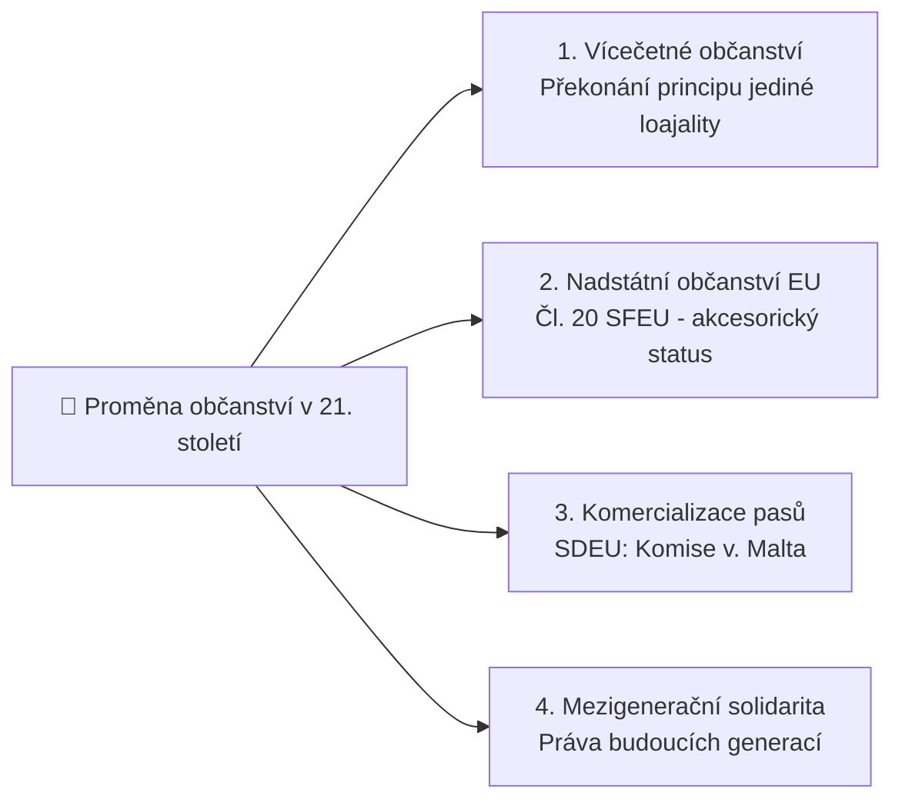

# Státní obyvatelstvo, personální výsost a občanství

## 1. Vymezení pojmu a struktura obyvatelstva
**[[státní obyvatelstvo]]** představuje personální substrát státu podle [[Georg Jellinek|Georga Jellineka]]. Jde o soubor fyzických osob, které trvale žijí na území státu a podléhají jeho suverénní moci.

Personální substrát se dělí do tří právních kategorií:
1. **Státní občané:** Osoby spojené se státem trvalým právním svazkem (občanstvím). Požívají plná politická práva (právo volit, být volen, účastnit se správy věcí veřejných) a nesou základní občanské povinnosti (věrnost, obrana vlasti).
2. **Cizinci:** Příslušníci jiných suverénních států, kteří pobývají na území (trvale či přechodně). Mají zaručena základní lidská práva a svobody, nikoli však plná politická práva.
3. **Apatridé (osoby bez státní příslušnosti):** Osoby, které žádný stát podle svých zákonů nepovažuje za své občany.

---

## 2. Personální výsost a kolize s územní výsostí
- **[[personální výsost]] (*ius personae*):**
  - Právní moc státu nad svými občany, která **nekončí na státních hranicích**.
  - Působí vůči občanovi i tehdy, když se nachází v zahraničí.
  - Zahrnuje: diplomatickou a konzulární ochranu, trestní jurisdikci nad trestnými činy spáchanými občanem v cizině (zásada personality), v některých státech daňové povinnosti (USA zdaňují své občany bez ohledu na místo pobytu).
- **Kolize výsostí:**
  - Pokud se český občan nachází ve Francii, podléhá primárně francouzské **[[územní výsost|územní výsosti]]** (musí dodržovat francouzské zákony), ale zároveň zůstává pod českou **personální výsostí** (Česká republika mu poskytuje konzulární ochranu a může jej stíhat za porušení českých zákonů).

---

## 3. Výzvy 21. století: Proměny vazby mezi občanem a státem

### A. Vícečetné a nadstátní občanství
- Tradiční pojetí 19. století odmítalo dvojí občanství jako „bigamii v právu“. Dnes většina demokratických států (včetně ČR od zákona č. 186/2013 Sb.) dvojí i víceré občanství plně připouští.
- **Občanství Evropské unie (čl. 20 Smlouvy o fungování EU):** Nenahrazuje národní občanství, ale doplňuje jej. Zakládá právo volného pohybu a pobytu v EU, právo volit do Evropského parlamentu a v komunálních volbách v místě bydliště a právo na diplomatickou ochranu kteréhokoli členského státu ve třetí zemi.

### B. Komercializace občanství: Případ *Komise v. Malta* (SDEU)
- Vláda Malty zavedla program udělování maltského občanství bohatým cizincům (tzv. „zlaté pasy“) výměnou za investici cca 1 milionu EUR a nákup nemovitosti, aniž by žadatelé měli na Maltě jakoukoli skutečnou vazbu nebo tam reálně žili.
- Evropská komise podala na Maltu žalobu u Soudního dvora EU:
  - **Argumentace Komise:** Maltské občanství automaticky zakládá občanství EU a právo volného pohybu po celé Unii. Udělování pasů za peníze bez reálného pouta (**genuine link** ve smyslu rozsudku Mezinárodního soudního dvora ve věci *Nottebohm*) porušuje zásadu loajální spolupráce (čl. 4 odst. 3 SEU) a degraduje podstatu unijního občanství na komerční zboží.

### C. Masová migrace a integrace
- Rozsáhlé uprchlické a migrační toky vyvolané válečnými konflikty, autoritářskými režimy a klimatickými změnami.
- Státní aparáty řeší otázku naturalizace, integrace a vztahu mezi univerzálními lidskými právy uprchlíků a suverénním právem státu kontrolovat vstup cizinců na své území.

### D. Intergenerační solidarita a zastoupení budoucích generací
- Nová státovědná otázka: *Zahrnuje pojem obyvatelstva pouze dnes žijící osoby, nebo i generace budoucí?*
- Průlomové rozhodnutí Spolkového ústavního soudu Německa (BVerfG, 2021, *Klimabeschluss*): Stát má ústavní povinnost chránit klima tak, aby dnes žijící generace nevyčerpala emisní rozpočet na úkor budoucích generací a nepřipravila je o základní svobody.

---

### Související poznámky
- [[Klasické prvky státu a moderní výzvy (Georg Jellinek)]]
- [[Jellinekova tříprvková definice státu]]
- [[Státní území, územní výsost a teritoriální integrita]]
- [[Organizace studia, zkouška a literatura]]

### References / Zdroje
- [[Přednáška 1 - Úvod do státovědy (Kindlová)]] (blok 4)
- [[Učebnice - Státověda (Kindlová a kol.)]]
