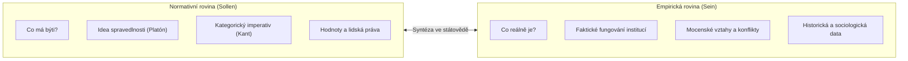

# Státověda jako právní disciplína a předporozumění

## 1. Proč právníci potřebují státovědu?
Když student práv otevírá text Ústavy České republiky, setkává se s pojmy jako **stát**, **suverenita**, **lid jako zdroj moci**, **dělba moci** či **vláda práva**. Tyto pojmy však ústavodárce v textu zákona nedefinuje – jejich obsah totiž předpokládá jako samozřejmý.

Zde vstupuje do hry koncept **[[předporozumění]]** (*Vorverständnis*):
- Jde o nezbytnou konceptuální mřížku a myšlenkový horizont, který předchází konkrétnímu pozitivnímu právu.
- Bez předporozumění by byl právník odkázán na doslovný mechanický výklad bez pochopení hlubšího smyslu a účelu právních institutů (*ratio legis*).
- Státověda poskytuje právě tuto systematickou konceptuální výbavu.

> [!NOTE] **Státověda jako „obecná část ústavního práva“**
> V německé a středoevropské tradici se státověda (*Staatslehre*) často neformálně označuje za obecnou část ústavního práva. Zároveň je však plnohodnotnou, autonomní vědeckou disciplínou, která ústavní právo přesahuje do politologie a filozofie.

---

## 2. Pět fundamentálních otázek státovědy
Státověda se nezabývá pouhou technikou tvorby norem, nýbrž klade zásadní ontologické a teleologické otázky:
1. **Co je stát?** (Jaké jsou jeho definiční znaky, hranice a atributy?)
2. **Proč stát vzniká?** (Z jaké potřeby se lidé organizují do vrchnostenského celku?)
3. **Co stát udržuje pohromadě?** (Jaké instituce, symboly a legitimizační faktory zajišťují stabilitu řádu?)
4. **Jak stát zaniká?** (Rozpad, anexe, debellace, revoluce, klimatické faktory?)
5. **Kdo v něm má vládnout a z jakého titulu?** (Otázka legitimity, forem vlády a politických režimů?)

---

## 3. Propojení normativity a empirie
Státověda se pohybuje na rozhraní dvou světů:

- **Rovina normativity (*Sollen*):** Zkoumá ideální cíle státu, morální opodstatnění práva a spravedlnost.
- **Rovina empirie (*Sein*):** Zkoumá reálné chování lidí, institucí, vlád a ozbrojených složek v dějinách.
- Plnohodnotná státověda nesmí sklouznout ani do naivního moralizování odtrženého od reality, ani do cynického popisu mocenského násilí bez hodnotového ukotvení.

---

## 4. Státověda jako funkční „patchwork“
Státověda je výrazně **interdisciplinární obor**. Lektorka přednášky doc. Miluše Kindlová ji přirovnává k funkčnímu mozaikovitému patchworku, který propojuje:
- **Dějiny státu a práva:** Poskytují historický kontext vývoje institucí.
- **Politologii:** Nabízí modely volebních systémů, politických stran a forem vládnutí.
- **Sociologii:** Zkoumá společenskou stratifikaci, loajalitu obyvatelstva a Weberovy modely autority.
- **Mezinárodní vztahy a mezinárodní právo:** Analyzují vnější suverenitu, uznání států a globální řád.

---

### Související poznámky
- [[Úvod do předmětu a role státovědy]]
- [[Ernst-Wolfgang Böckenförde vs Charles Tilly (Definice státu)]]
- [[Alegorie dobré vlády (Ambrogio Lorenzetti)]]

### References / Zdroje
- [[Přednáška 1 - Úvod do státovědy (Kindlová)]] (blok 1)
- [[Učebnice - Státověda (Kindlová a kol.)]]
- [[Studentské výpisky - Statoveda prednaska 1]]
