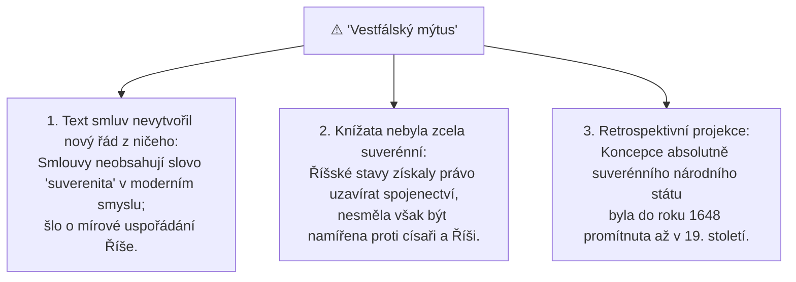

# Vestfálský mír a vestfálský mýtus

## 1. Vestfálský mír (1648) a konec třicetileté války
Vestfálský mír představuje soubor dvou smluv podepsaných 24. října 1648 v městech Münster a Osnabrück:
- *Instrumentum Pacis Monasteriense* (IPM) – mír mezi Svatou říší římskou a Francií.
- *Instrumentum Pacis Osnabrugense* (IPO) – mír mezi Svatou říší římskou a Švédskem.

Tímto mírem byla ukončena krvavá třicetiletá válka (1618–1648), která zpustošila střední Evropu a rozbila představu o nábožensky a politicky jednotném křesťanském impériu.

---

## 2. Tradiční státovědný výklad: „Vestfálský systém“
V klasické státovědě a teorii mezinárodních vztahů je rok 1648 oslavován jako **zrození moderního mezinárodního práva a mezinárodního systému**:
1. **Zánik univerzalismu:** Definitivní konec nadřazenosti císaře a papeže nad suverénními evropskými státy.
2. **Suverénní rovnost států:** Všechny státy – bez ohledu na velikost, vojenskou sílu či formu vlády (monarchie či republika) – jsou si formálně rovny.
3. **Zásada nevměšování (*non-intervention*):** Zákaz cizího zasahování do vnitřních věcí suverénního státu. Každý panovník má právo určit náboženství a zákony na svém území (*cuius regio, eius religio*).
4. **Teritorialita:** Právní řád je vázán na jasně vymezené státní hranice.

---

## 3. Moderní kritika: „Vestfálský mýtus“
V posledních desetiletích historici mezinárodního práva (např. Stephen Krasner, Andreas Osiander, Derek Croxton) podrobili tradiční narativ důkladné kritice a označili jej za **„Vestfálský mýtus“** (*Westphalian myth*):

- **Závěr pro zkoušku:** Vestfálský mír nebyl náhlým magickým „třeskem“, který z ničeho nic stvořil moderní suverenitu, ale byl **klíčovým symbolickým a právním stvrzením** dlouhodobého procesu teritorializace a emancipace států, který probíhal po celá staletí.

---

### Související poznámky
- [[Historický vývoj státnosti a vznik suverenity]]
- [[Boj o monopol moci a vznik moderního státu]]
- [[Jean Bodin a absolutní pojetí suverenity]]

### References / Zdroje
- [[Přednáška 1 - Úvod do státovědy (Kindlová)]] (blok 3)
- [[Učebnice - Státověda (Kindlová a kol.)]]
