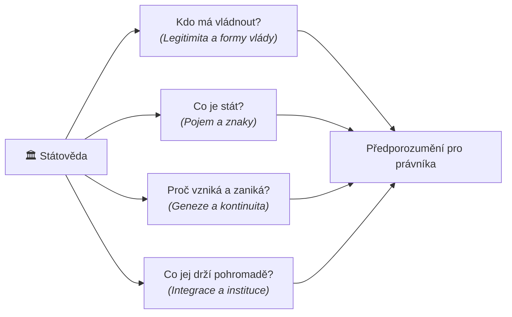

# Nadřazené téma: Úvod do předmětu a role státovědy

## Úvod a syntéza
Proč se budoucí právníci učí státovědu hned v úvodu studia, když na první pohled neobsahuje paragrafy konkrétních zákonů?
Odpověď spočívá v konceptu **[[předporozumění]]**. Pozitivní právní normy (např. čl. 1 odst. 1 Ústavy ČR: *„Česká republika je svrchovaný, jednotný a demokratický právní stát...“*) používají pojmy, které samy o sobě nedefinují. Právník, který nezná teoretickou a historickou podstatu pojmů jako stát, suverenita, legitimita či dělba moci, není schopen ústavní text fundovaně interpretovat ani aplikovat.

Státověda plní úlohu **obecné části ústavního práva**, přestože je samostatnou a svébytnou vědeckou disciplínou.

---

## Základní osy zkoumání státovědy

---

## Klíčová podtémata a studijní poznámky

### 1. [[Státověda jako právní disciplína a předporozumění]]
- Detailní rozbor role konceptuální mřížky pro právní myšlení.
- Vztah k ústavnímu právu: státověda jako teoretický fundament a pojmové zázemí.
- Dvojí rovina státovědy:
  - **Normativita (*Sollen* – co má býti):** Filozofické otázky spravedlnosti, dobra a legitimity (Platón, Kant).
  - **Empirie (*Sein* – co reálně je):** Pozorování skutečného historického a současného chování států, mocenských struktur a institucí.
- Metodologie: Státověda jako **funkční „patchwork“** – integruje dějiny státu a práva, politologii, sociologii i teorii mezinárodních vztahů.

### 2. [[Alegorie dobré vlády (Ambrogio Lorenzetti)]]
- Slavná freska v Sienské radnici (*Palazzo Pubblico*, 1338–1339) jako vizuální a symbolická metafora pro cíl státovědy.
- Personifikace spravedlnosti (*Iustitia*), svornosti (*Concordia*) a společného dobra (*Bene Comune*) vs. freska špatné vlády (*Tyrannide*).
- Poselství: Účelem státovědy je hledat institucionální pravidla pro dobrý a spravedlivý společný život občanů.

---

## Shrnutí k zapamatování pro zkoušku
- Státověda dodává právníkům **předporozumění** – základní pojmovou výbavu před čtením norem.
- Zkoumá 5 základních otázek: *co je stát, proč vzniká, co jej udržuje, jak zaniká a kdo má vládnout*.
- Propojuje **normativitu** (ideál spravedlnosti) s **empirií** (sociologická a historická realita).
- Je mezioborovou syntézou (patchworkem) práva, politologie, sociologie a historie.

---

### Související nadřazená témata
- [[00 Státověda 01 - Pojem státu, jeho prvky a suverenita (Rozcestník)]]
- [[Teorie vzniku státu a vymezení pojmu]]
- [[Historický vývoj státnosti a vznik suverenity]]
- [[Klasické prvky státu a moderní výzvy (Georg Jellinek)]]
- [[Organizace studia, zkouška a literatura]]
